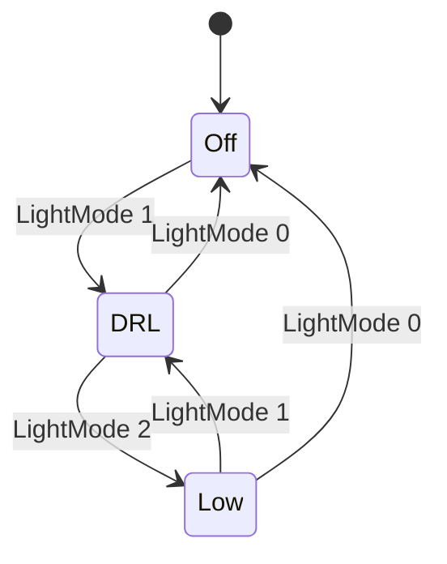

# Exterior lighting: light-mode input review

Review of EL-BEAM-1.1, the assumption LightingControl places on
LightingRequestSensing, against every SCCM input mapping in
`remotive_car/models/sccm/python/config/`.

## The assumption

BCM_Lighting's `BeamsStateMachine` (`models/bcm/python/bcm/state_machines/beams.py`)
accepts only these transitions:

`ignore_invalid_triggers=True` makes it drop LightMode 2 while in Off. The
design is correct for a rotary light switch, which cannot reach LowBeam
without passing DaylightRunningLight. EL-BEAM-1.1 states this as an
assumption: LightStalk.LightMode only steps between adjacent positions and
holds each for at least one 50 ms DriverCan0 cycle.

## Findings per mapping

| Mapping | LightMode | HighBeam | EL-BEAM-1.1 |
|---|---|---|---|
| `moza.gateway-mapping.yaml` | three detents mapped to 0, 1, 2 | `LightStalk.HighBeam` | met |
| `moza_v2.gateway-mapping.yaml` | three detents mapped to 0, 1, 2 | `LightStalk.HighBeam` | met |
| `logitech.gateway-mapping.yaml` | one button mapped 0 → 0, 1 → 2 | `LightControl.HighBeam` | **not met** |
| `google.gateway-mapping.yaml` | not mapped | not mapped | not applicable |

Logitech G29:

1. **Low beam never comes on.** The button jumps LightMode from 0 to 2. The
   BCM ignores the jump and stays Off, and releasing the button sends 0, so
   the lamps never leave Off.
2. **High beam cannot be requested.** The button writes
   `LightControl.HighBeam`, a frame `driver_can.dbc` does not define. The
   BCM listens to `LightStalk.HighBeam`.

## Options

| Option | Change | Effect on the breakdown |
|---|---|---|
| A, recommended | Map the G29 button as a cycling switch 0 → 1 → 2 → 0 and fix the high-beam target to `LightStalk.HighBeam` | EL-BEAM-1.1 holds for every mapping; no change to BCM_Lighting |
| B | Let `BeamsStateMachine` accept every transition | EL-BEAM-1.1 is no longer needed; EL-BEAM-1.2 changes; BCM is retested |

Until one option is implemented, EL-BEAM-1 stays *accepted*, and
SatisfactionClaim_NonSafety_ImplementedSCCM_Lighting and
SatisfactionClaim_NonSafety_ImplementedExteriorLightingDesign explicitly
exclude it.
