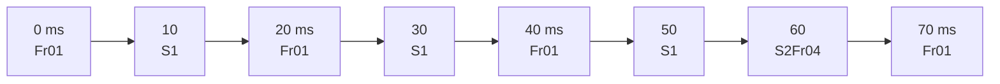
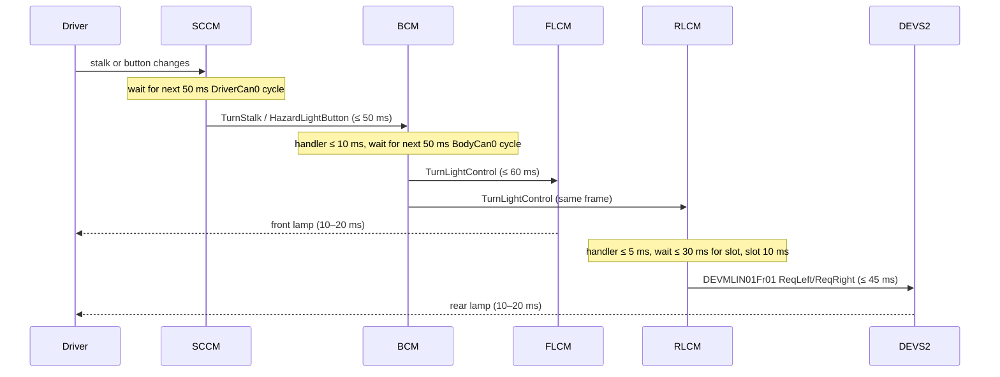

# Exterior lighting: direction-indicator response time analysis

Worst-case analysis for EL-RSP-1: a change of the turn stalk or the hazard
warning button shall show on every affected direction-indicator lamp within
200 ms, and the front and rear lamps of one side shall change no more than
80 ms apart.

## Inputs

| Input | Value | Source |
|---|---|---|
| DriverCan0 HazardLightButton, TurnStalk, LightStalk cycle | 50 ms | `remotive_car/platform/databases/driver_can.dbc`, GenMsgCycleTime of frames 100, 101, 103 |
| BodyCan0 TurnLightControl cycle | 50 ms | `remotive_car/platform/databases/body_can.dbc`, GenMsgCycleTime of frame 103 |
| TurnLightControl receivers | DIM, FLCM, RLCM, GWM | `body_can.dbc`, one broadcast frame |
| RearLightLIN bit rate | 19.2 kbit/s | `remotive_car/platform/databases/rearlight.ldf` |
| RearLightLIN schedule DEVMLIN01Schedule01 | Fr01, S1, Fr01, S1, Fr01, S1, S2Fr04, 10 ms each, 70 ms table | `rearlight.ldf` |
| RLCM master time base / jitter | 5 ms / 1 ms | `rearlight.ldf`, Nodes |
| BCM output on state entry | first on-phase is written when the state is entered, not at the first blink tick | `models/bcm/python/bcm/__main__.py`, `on_turn_stalk`, `on_hazard_button` |
| RLCM forwarding | ReqLeft/ReqRight written on every TurnLightControl frame | `models/rlcm/python/rlcm/__main__.py`, `on_turn_req_frame` |
| FLCM, DEVS2 lamp reaction | 10–20 ms from frame to lamp | supplier commitment, input filter plus LED rise; assumed, see EL-RSP-1.3 and EL-RSP-1.4.2 |

## LIN slot gap

DEVMLIN01Fr01 starts at 0, 20 and 40 ms of the 70 ms table. The gaps are
20, 20 and 30 ms (40 ms to 70 ms, the next table start). A value written by
RLCM just after a slot started waits at most **30 ms** for the next slot and
is on the bus at the end of that 10 ms slot.

## Chain

| Segment | Min | Max | Allocated to |
|---|---|---|---|
| Input change to DriverCan0 frame | 0 | 50 | EL-RSP-1.1 SCCM_Lighting, DriverCan0 |
| DriverCan0 frame to TurnLightControl sent | 0 | 60 | EL-RSP-1.2 BCM_Lighting, BCM_ECU, BodyCan0 |
| TurnLightControl to front lamp | 10 | 20 | EL-RSP-1.3 FLCM_Lighting |
| TurnLightControl to LIN value written | 0 | 5 | EL-RSP-1.4.1 RLCM_Lighting, RLCM_ECU |
| LIN wait for slot plus slot | 0 | 40 | RearLightLIN |
| DEVMLIN01Fr01 to rear lamp | 10 | 20 | EL-RSP-1.4.2 DEVS2_Lighting |
| **TurnLightControl to rear lamp** | **10** | **65** | EL-RSP-1.4 RearLight |

## Results

| Criterion | Worst case | Limit | Margin |
|---|---|---|---|
| Input to front lamp | 50 + 60 + 20 = 130 ms | 200 ms | 70 ms |
| Input to rear lamp | 50 + 60 + 65 = 175 ms | 200 ms | 25 ms |
| Rear lamp later than front lamp | 65 − 10 = 55 ms | 80 ms | 25 ms |
| Front lamp later than rear lamp | 20 − 10 = 10 ms | 80 ms | 70 ms |

Front and rear lamps are driven from the same TurnLightControl
transmission, so the CAN segments cancel out of the phase offset; only the
rear path's LIN hop and the lamp reactions remain.

## Sensitivities

- The 30 ms LIN gap is the largest single term in the phase offset. Adding a
  frame to the 40–70 ms span of DEVMLIN01Schedule01 without repeating
  DEVMLIN01Fr01 consumes the 25 ms margin of both the rear-lamp latency and
  the phase offset. This is why the gap is a constraint on RearLightLIN.
- Raising the BodyCan0 TurnLightControl cycle above 75 ms breaks the 200 ms
  rear-lamp limit.
- The blink period itself (BCM ticker, 1.0 s per phase) does not enter this
  analysis: it is the subject of the safety contracts on TurnLightRequest
  cadence, not of EL-RSP-1.
