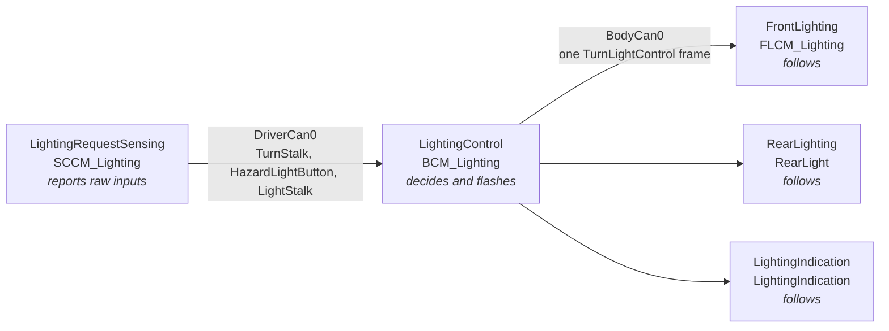
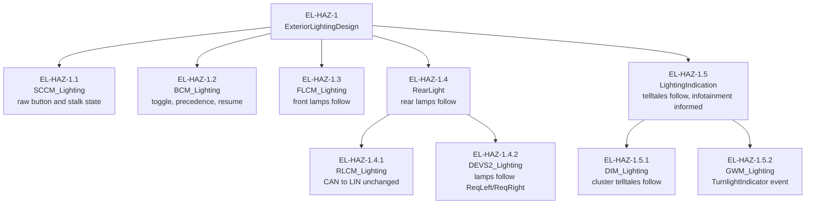
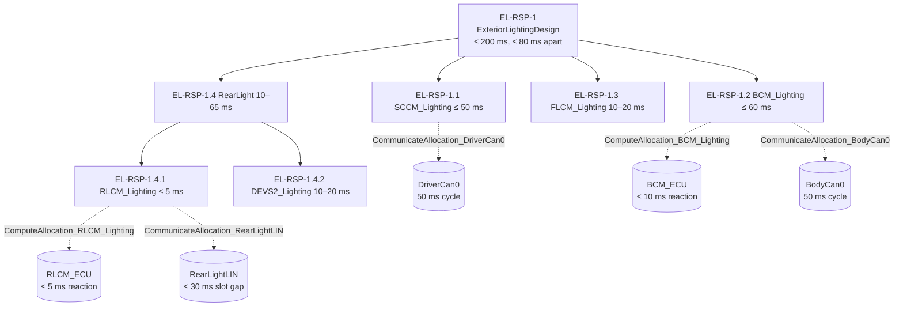
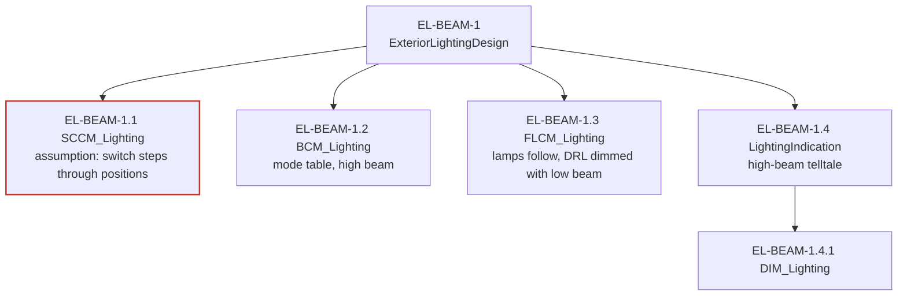

# Exterior lighting: breakdown of the informal requirements

This note justifies how the three top-level informal requirements of
ExteriorLightingDesign are refined over the realization, down to the atomic
components whose code or interface specification implements them. It is the
evidence cited by every `RationaleClaim_NonSafety_Composition` of the
exterior lighting.

| Id | Requirement | Status |
|---|---|---|
| EL-HAZ-1 | Hazard warning toggles on each press, overrides the turn stalk, resumes stalk side when off | reviewed |
| EL-RSP-1 | Indicator lamps respond within 200 ms, front and rear of a side at most 80 ms apart | reviewed |
| EL-BEAM-1 | Front lamps follow light mode and high beam; high-beam telltale | accepted, open finding |

## Design principle used throughout

Flashing and every decision about which side flashes are made **once**, in
LightingControl (BCM_Lighting). Every other building block only follows the
requests it receives. Because all followers consume the **same** CAN frame,
`TurnLightControl` on BodyCan0, the lamps and telltales stay in phase without
any synchronisation between FLCM, RLCM, DEVS2 and DIM. This is what lets each
top-level requirement split cleanly into one decision obligation and several
follow obligations.

## EL-HAZ-1 Hazard warning

Why the children imply the parent:

- *Toggle on each press of at least 100 ms.* DriverCan0 samples the button
  every 50 ms (EL-HAZ-1.1), so a 100 ms press appears as 1 in at least one
  frame. BCM_Lighting toggles on the 0 to 1 edge (EL-HAZ-1.2), so a held
  button toggles once, not every cycle.
- *All four lamps and both telltales flash together.* BCM_Lighting sets both
  requests to the same value in the same frame (EL-HAZ-1.2); FLCM, RearLight
  and the DIM follow that frame without timing of their own (EL-HAZ-1.3,
  1.4, 1.5).
- *Resume on the stalk side.* BCM_Lighting keeps the last stalk position and
  returns to it on switch-off (EL-HAZ-1.2); SCCM keeps reporting the stalk
  while hazard is on (EL-HAZ-1.1).
- RL (RearLight) carries no obligation: it only answers RLCM's diagnostic
  counter and drives no turn lamp.
- IHU (LightingIndication) carries no obligation from EL-HAZ-1. The cluster
  telltale is the operating indication; the infotainment mirror is a
  convenience. EL-HAZ-1.5.2 only makes the state available to it. The
  IHU_Lighting event handler is a stub today, which this requirement does not
  depend on.

## EL-RSP-1 Response time and phase

The budget is derived and checked in `EL_Indicator_Response_Time_Analysis.md`.
Allocation to the application components follows the signal path; the parts
of each budget that the platform delivers (bus cycle, LIN schedule, ECU
scheduling) are allocated further to the platform components that the
existing Compute and Communicate allocations place the components on.

## EL-BEAM-1 Light mode and high beam

BCM_Lighting's beam state machine models a rotary switch: it only steps
Off ↔ DaylightRunningLight ↔ LowBeam. That design is correct only under the
assumption EL-BEAM-1.1 places on LightingRequestSensing. The breakdown made
the assumption explicit, and checking it against the SCCM mappings found that
the Logitech G29 mapping breaks it; see `../analysis/EL_Beam_Mode_Review.md`.
EL-BEAM-1 therefore stays *accepted* and is not argued as satisfied at
ExteriorLightingDesign.
